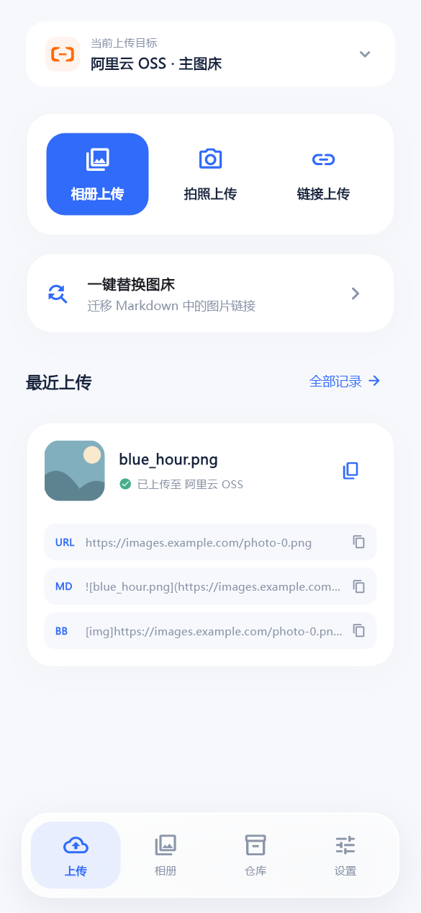
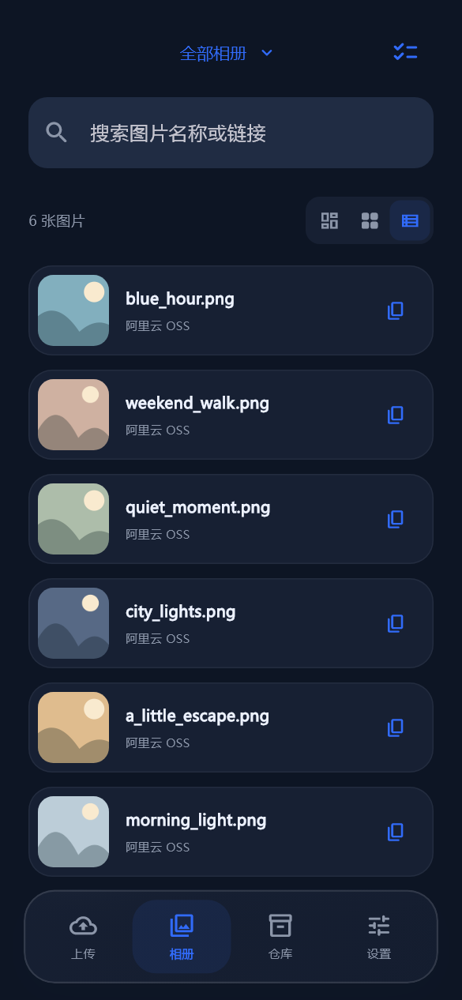
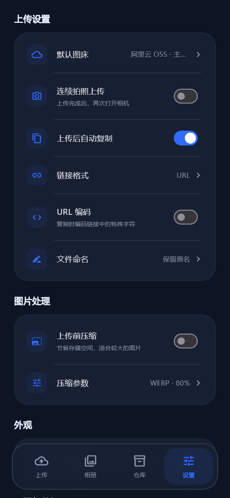

<div align="center">
  
  <h1>Picora</h1>
  <p>Android 图床与对象存储聚合客户端</p>
</div>

## 简介

Picora 是 [PicHoro](https://github.com/Kuingsmile/PicHoro) 的派生项目，基于 [PicHoro v3.0.1](https://github.com/Kuingsmile/PicHoro) 修改而来并独立维护。

Picora在继承[PicHoro](https://github.com/Kuingsmile/PicHoro)大部分功能与逻辑的基础上，添加了更加现代化的界面，并以[PicGo](https://github.com/Molunerfinn/PicGo)的工作流为参考，提供图片上传、相册管理和图床插件扩展。

## 功能

- 相册、拍照、链接和系统分享上传，支持批量上传与失败重试。
- URL、Markdown、Discuz / BBCode 链接复制。
- 相册支持瀑布流、网格、列表，以及搜索、筛选和多选管理。
- 同一图床可添加多组配置，支持默认目标和快捷切换。
- Markdown 图片迁移：下载原图、上传到指定图床、替换链接。
- 自定义文件命名、图片处理、配置导入导出和诊断日志。
- 浅色 / 自动 / 深色主题。

## 支持的图床与存储

阿里云 OSS、腾讯云 COS、七牛云、又拍云、S3 兼容存储、GitHub、SM.MS、Imgur、兰空图床、OpenList(Alist)、WebDAV、FTP / SFTP、自定义 Web 图床。

## 插件
Picora支持自定义插件，理论上可以通过插件实现对任何图床的适配支持。

原生插件使用 ZIP + JSON HTTP 协议，支持插件仓库下载、资源图标、离线教程和同 ID 更新。

同时Picora对部分PicGo插件适配，可通过 PicGo Bridge 调用。

[插件文档](https://github.com/Alnitak44/picora-plugins/tree/main/docs) · [插件模板](plugins/template)
## 下载

[GitHub Releases](https://github.com/Alnitak44/Picora/releases)

## 应用展示

<p align="center">
  
  
  
  
</p>

## 开发

Flutter **3.35.7** / Dart **3.9.2**，JDK **21**，Android SDK **36**，NDK **27.0.12077973**。

```sh
flutter pub get --enforce-lockfile
flutter analyze --no-pub lib/app lib/main.dart test
flutter test --no-pub
flutter build apk --debug --no-pub --split-per-abi
```

## 项目结构

| 路径 | 内容 |
| --- | --- |
| `lib/main.dart` | 入口：初始化路由与全局异常捕获 |
| `lib/app/` | Picora 自研前端：四个主页、控制器、主题、诊断与插件运行时 |
| `lib/legacy/` | 继承自 PicHoro 的上游实现：各图床 API、云端文件管理页、通用组件与路由表 |
| `plugins/` | 插件模板 |
| `docs/` | 功能说明与上游 README 存档 |
| `android/`、`ios/` | 原生工程；`android/vendor/` 为 PDF 组件的本地补丁 |
| `scripts/` | 本机构建脚本；`tools/` 为插件打包等辅助工具 |

新代码写在 `lib/app/`；`lib/legacy/` 保留上游页面以支撑云端文件管理，改动时保持最小侵入。

## 架构

- `hero_app.dart` / `hero_theme.dart`：四页导航、玻璃底栏、转场、系统分享接收与设计系统。
- `upload_page.dart`、`album_page.dart`、`repositories_page.dart`、`settings_page.dart`：四个主页面。
- `controller.dart` / `models.dart`：配置选择、上传预处理、上游 API 调用与相册记录；字段与上游十二种图床一致。
- `config_exchange.dart`：备份与 PicHoro / PicGo / PicList 参数转换，导入前校验必填字段。
- `diagnostics.dart` / `diagnostics_page.dart`：结构化异常记录与导出。
- `lib/app/plugins/`：ZIP 插件包、清单校验、HTTP 模板运行时与 PicGo Server 桥接。

默认图床按配置 ID 保存，临时目标只在当前会话生效。上传开始时固定配置快照，整批使用同一目标，期间禁止切换或编辑配置；失败不入库，部分成功保留记录并可重试。数据库位于应用私有目录，不共用旧项目的 Downloads 数据库，旧配置需显式导入。仓库不预设假配置，首次运行把尚未收录的上游活动配置迁入空位，每类只迁移一次。

诊断日志写入应用支持目录 `picora-diagnostics.jsonl`，保留最近 300 条。密钥、Token、Authorization、Cookie 与签名 URL 参数自动脱敏，导出不含凭据。

## 文档

- [文件命名与 Markdown 图片迁移](docs/MARKDOWN_MIGRATION.md)
- [上游 README](docs/UPSTREAM_README.md)

## License

本项目使用[MIT](LICENSE)开源协议。
保留上游版权，Picora 的修改与新增部分归 Alnitak44 和贡献者所有。

```text
Copyright (c) 2022-present, Kuingsmile
Copyright (c) 2026 Alnitak44 and Picora contributors
```

[第三方声明](THIRD_PARTY_NOTICES.md) · [更新日志](Version_update_log.md)
